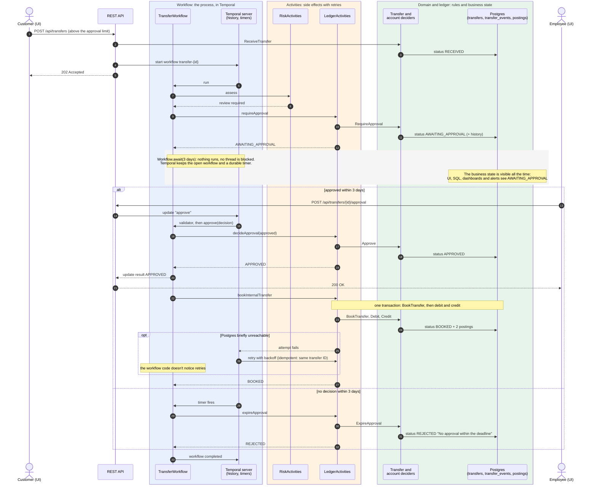

# Architecture

Decisions behind it: [decisions](decisions/README.md).

## Modules

```
domain/          fmodel deciders (account, transfer) and risk rules: pure business logic, only fmodel + coroutines
payment-messages/  the ISO 20022 messages banks and the clearing house exchange (pacs.008, pacs.002, pacs.028)
clearing/        the clearing house (#58): its own service between the banks, see below
observability/grafana/  dashboards and alert rules, mounted into the LGTM container by compose.yaml
observability/otel-collector/  collector config for Temporal server and Postgres metrics and logs
bank-service/
  ledger/        event repositories (postings, transfer history), Ledger (transactions, locks), queries
  workflow/      TransferWorkflow
  activities/    LedgerActivities, RiskActivities, ExternalBankActivities
  externalbank/  external bank simulator: slow, fails technically, sometimes rejects
  api/           REST
  config/        Temporal data converter, OpenTelemetry log appender, which requests get traced
  observability/ span attributes, UI config, OTLP proxy for the browser
  resources/static/  the UI (HTML, CSS, JS); telemetry.js and vendor/otel-web.js for browser telemetry
  ui-telemetry/  build of the vendored OpenTelemetry bundle (npm + esbuild, not part of the Gradle build)
```

## How a transfer works

The API receives the transfer in the ledger (status `RECEIVED`) and starts the workflow (`TransferWorkflow`, workflow
ID `transfer-<transferId>`):

1. `RiskActivities.assess`: if the amount exceeds the limit, the ledger records `AWAITING_APPROVAL` and the workflow
   waits up to 3 days for the `approve` update. The ledger then records the decision: `APPROVED`, or `REJECTED` when
   denied or not decided in time.
2. **Internal:** one activity, one database transaction: the status `BOOKED`, debit and credit. No saga needed.
3. **External bank (saga):** debit, the money goes to the clearing account (`SENT_TO_EXTERNAL_BANK`) → external bank
   → `COMPLETED`, or `REFUNDED` on rejection.

Who decides what ([decision 0007](decisions/0007-workflow-runs-the-process-domain-decides-and-records.md)):

| | Decides | Lives in |
| --- | --- | --- |
| Transfer decider | which status change is allowed, rejection reasons | `domain`, run by the ledger |
| Account decider | whether money may move: funds, overdraft, blocked or closed accounts | `domain`, run by the ledger |
| Workflow | when a step is attempted, waiting, deadlines, retries, compensation | Temporal |

```
RECEIVED ─┬───────────────────────────────┬─→ BOOKED                      (internal, deposit)
          └→ AWAITING_APPROVAL → APPROVED ┴─→ SENT_TO_EXTERNAL_BANK ─┬→ COMPLETED
                                                                      └→ REFUNDED
RECEIVED, AWAITING_APPROVAL, APPROVED ─→ REJECTED (nothing booked)
```

### A transfer with an approval, step by step

- **Blue, the workflow:** the process itself. It decides what comes next, waits and reacts to the approval or the
  deadline.
- **Orange, the activities:** every side effect, retried by Temporal until it succeeds.
- **Green, domain and ledger:** the rules (deciders) and the business state (Postgres). They are the only place that
  decides whether a step is allowed and what the status becomes.



## Ledger

- Every posting is an immutable row in `postings` (a trigger forbids UPDATE and DELETE). The balance is their sum.
- A deferred constraint trigger enforces at commit time that every transfer sums up to zero.
- The `AccountEventRepository` locks the account row with `SELECT … FOR UPDATE` and hands the postings to the decider
  as events. Accounts are always locked sorted by ID, so there are no deadlocks.
- A booking step runs both deciders in one transaction: first the transfer decider (is the step allowed, or did it
  already happen?), then the account decider for debit and credit. If an account rejects, everything is rolled back
  and the transfer is rejected instead. Locks: always the transfer row first, then the accounts.
- Idempotency: the first decision for a transfer ID stands, even across activity retries. On top of that there's
  the unique constraint `(transfer_id, account_id, leg)`.
- `transfers.status` is the current business status; `transfer_events` keeps every change with its reason (append-only,
  like the postings). `GET /api/transfers/{id}/history` and the transfer drawer in the UI show it.
- System accounts: cash (`…0001`) for deposits, clearing account for external banks (`…0002`), settlement account at
  the clearing house (`…0003`). They may go negative and have no IBAN.
- Every customer account has an IBAN of this bank: `DE`, check digits, the bank code from `bank.identity` and a
  10-digit account number from a sequence. The `Iban` value object in `domain` validates and builds it; its
  `toString()` masks it, so it doesn't end up in logs by accident.

## One service, several banks

The same bank-service runs as bank A (defaults) and bank B (profile `bank-b`): own identity (`bank.identity`: name,
BIC, bank code), own Postgres schema, own Temporal namespace, own `service.name` (`bank-a`, `bank-b`) in the
telemetry. `BankInstancesTest` checks that the two configurations share nothing but the containers.

## The clearing house

A separate service (`clearing`, port 8090) between the banks, modelled on a SEPA Instant clearing and settlement
mechanism (#55). It has its own Postgres schema and Temporal namespace (`clearing`) and the same split as the banks
([decision 0007](decisions/0007-workflow-runs-the-process-domain-decides-and-records.md)):

- **Books:** a settlement account per participant (central bank money, funded at startup), a `reserved` account for
  payments in flight, double-entry postings per payment. The payment decider decides every status change.
- **One workflow per payment** (`payment-<uetr>`):
  1. reserve the amount on the debtor bank's settlement account; without enough liquidity: rejected (`AM04`);
  2. forward the `pacs.008` to the creditor bank, routed by the bank code in the IBAN (unknown bank: `RC01`);
  3. wait for its `pacs.002` (an update) until the deadline, 10 seconds;
  4. on acceptance settle (reserved → creditor bank), otherwise release the reservation (the creditor's reason code,
     or `AB05` without an answer in time);
  5. confirm the result to both banks.
- **API** (`/api/clearing`): `pacs008` from debtor banks, `pacs002` answers from creditor banks, `pacs028` status
  inquiries, and for operations the payments, the settlement balances and chaos settings (delayed or lost forwards).
- Banks receive messages at `POST /api/clearing/inbound/pacs008` and `…/pacs002`; the banks implement them in #59 and
  #60.

## Architecture rules

`ArchitectureTest` (ArchUnit) turns the module boundaries and Temporal's determinism rules into tests:

- Workflow code doesn't depend on the ledger, the API, Spring, JDBC, coroutines or fmodel. It only knows Temporal
  and its activity contracts.
- Workflow code doesn't call `Instant.now()`, `System.currentTimeMillis()`, `UUID.randomUUID()`, `Thread.sleep()`,
  `Random`, … (use `Workflow.currentTimeMillis()`, `Workflow.randomUUID()`, `Workflow.sleep()`).
- The domain only depends on Kotlin, coroutines and fmodel; the ledger doesn't know its callers; controllers don't
  touch SQL.
- A deliberately broken fixture (`NonDeterministicWorkflow`) proves the rules actually fire.

## Temporal connection

`spring.temporal.connection.target` is `localhost:7233`, not the `local` shortcut. With
`local`, the SDK reported no `temporal_*` metrics in this setup.
