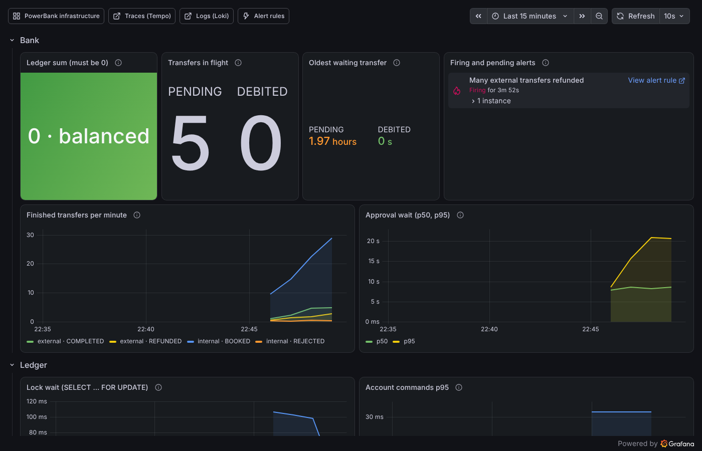

# Showcase

The whole system in Docker, with demo traffic, so dashboards, traces and alerts have something to show right away.
You only need Docker; the bank-service is built inside Docker.



```bash
docker compose --profile showcase up -d --build --wait
```

The first build takes a few minutes (Gradle downloads its dependencies inside Docker); later builds reuse the cache.
`./gradlew showcaseUp` does the same.

| What runs | Where |
| --- | --- |
| UI and API | http://localhost:8080 |
| Grafana: dashboards *PowerBank overview* and *PowerBank infrastructure*, traces, logs, alerts | http://localhost:3000 |
| Temporal UI | http://localhost:8233 |
| `traffic`: the demo generator ([`showcase/traffic.py`](../showcase/traffic.py)) | `docker compose logs -f traffic` |

Stop it all (add `-v` to delete the data, too):

```bash
docker compose --profile showcase down
```

Don't run it next to `./gradlew :bank-service:bootRun`: both use port 8080.

## What the demo traffic does

About one action every second or two, through the same REST API the UI uses:

- **Accounts:** opens six accounts with deposits.
- **Everyday traffic:** internal transfers and deposits. No transfers to other banks for now: they go through the
  clearing house (which the showcase starts too), and until bank B answers payments (#60) every one would be
  rejected. They come back with #62.
- **Approvals:** now and then a transfer above the approval limit. The generator approves or denies it 5 to 20 seconds later; 7 out of 10 get approved.
- **Bursts:** sometimes 10 concurrent transfers between the same two accounts, to show the row locks at work.

The accounts have no names: the bank only knows pseudonymous IDs (see [decision 0004](decisions/0004-no-personal-data-in-telemetry.md)).

## A tour in ten minutes

1. **The UI** (http://localhost:8080): transfers keep coming in. The generated accounts show up with their IDs, because nicknames only live in your browser. Open two accounts of your own with *New account* (give them nicknames), deposit something and send a transfer between them.
2. **One transfer from the click to the SQL:** open your transfer in the drawer and follow *Trace in Grafana*. You see the click in the browser (`bank-ui`), the REST call, the workflow with its activities, the row lock and the SQL statements, all in one trace.
   The transfers of the generator have the same trace, only without the browser part. An external transfer you send
   in the UI shows the reservation, the `pacs.008` to the clearing house (`bank.clearing.call`) and, in the same
   trace, the clearing house's own spans.
3. **The overview dashboard** (Grafana → Dashboards → PowerBank → *PowerBank overview*):
   - transfers per minute by outcome;
   - the ledger sum, which stays at 0;
   - lock waits rising during a burst;
   - the calls to the clearing house.
4. **Alerts:** stop the clearing house (`docker compose stop clearing`) and send a few external transfers in the UI.
   They stay *Reserved*; "Clearing house not reachable" fires after about a minute, and after 5 minutes without a
   final status the transfers go *Under investigation* and "External transfer under investigation" fires. Start it
   again (`docker compose start clearing`): at the next status inquiry (every 10 minutes) the bank learns the clearing
   house never got the payments and refunds them.
5. **Approvals in Temporal** (http://localhost:8233): a `TransferWorkflow` waiting for an approval shows the workflow, its `status` query and, once decided, the `approve` update in its history. In the UI you can approve or deny it yourself before the generator does.
6. **Break something** and watch the system cope:
   - `docker compose stop temporal`: no transfer can start; after about two minutes "Temporal server down" fires. `docker compose start temporal`: everything continues where it stopped, because the workflows are on a volume.
   - `docker compose stop postgres`: bookings fail, Temporal retries the activities, and "Postgres unreachable" fires after about a minute. Start it again and the waiting transfers are booked.
   - `docker compose stop bank-service`: the worker is gone. Tasks of the transfers that were in flight pile up in the queue, for example the retries of external transfers, and "Nobody works on the bank task queue" fires, because the Temporal server measures it. `docker compose start bank-service` picks them up.
7. **The infrastructure dashboard** (*PowerBank infrastructure*) shows the Temporal server and Postgres during all this: request rates, task queue backlog, connections, locks, slow statements.

Where to go from here: [observability](observability.md) explains every signal, [architecture](architecture.md) how a transfer works.
