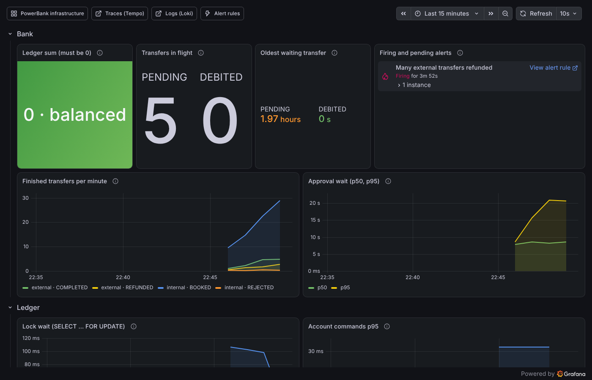

# Showcase

The whole system in Docker, with demo traffic, so dashboards, traces and alerts have something to show right away:
two banks, bank A (PowerBank) and bank B (Partner Bank), that pay each other through the clearing house (SEPA Instant).
You only need Docker; the services are built inside Docker.



```bash
docker compose --profile showcase up -d --build --wait
```

The first build takes a few minutes (Gradle downloads its dependencies inside Docker); later builds reuse the cache.
`./gradlew showcaseUp` does the same.

| What runs | Where |
| --- | --- |
| `bank-a`: bank A, UI (online banking, back office, operations) and API | http://localhost:8080 |
| `bank-b`: bank B, the same application with its own identity, database schema and Temporal namespace | http://localhost:8081 |
| `clearing`: the clearing house between them | http://localhost:8090/api/clearing |
| Grafana: dashboards *PowerBank overview*, *PowerBank clearing house* and *PowerBank infrastructure*, traces, logs, alerts | http://localhost:3000 |
| Temporal UI: namespaces `default` (bank A), `bank-b` and `clearing` | http://localhost:8233 |
| `traffic`: the demo generator ([`showcase/traffic.py`](../showcase/traffic.py)) | `docker compose logs -f traffic` |

Stop it all (add `-v` to delete the data, too):

```bash
docker compose --profile showcase down
```

Don't run it next to `bootRun` of the banks or the clearing house: they use the same ports.

To check that it works, run the smoke test that CI runs, too ([`showcase/smoke_test.py`](../showcase/smoke_test.py)):

- it waits for payments in both directions;
- it checks that both ledgers and the settlement accounts add up;
- it checks that one payment's trace spans all three services.

```bash
python3 showcase/smoke_test.py
```

## What the demo traffic does

About one action every second or two, through the same REST APIs the UIs use:

- **Accounts:** the back office of each bank opens five accounts with deposits, and one more that it closes right away.
- **Everyday traffic:**
  - internal transfers and deposits in both banks;
  - payments between the banks in both directions, through the clearing house. Now and then a payment goes to the
    other bank's closed account (rejected with `AC04`) or to an account it doesn't have (`AC01`).
- **Approvals:** now and then a transfer above the approval limit. The generator approves or denies it 5 to 20 seconds later; 7 out of 10 get approved.
- **Bursts:** sometimes 10 concurrent transfers between the same two accounts, to show the row locks at work.
- **Chaos at the clearing house:** after 10 minutes, the four phases below run one after another, with 15 minutes of
  normal traffic in between. Each phase sets the clearing house's chaos settings, the same ones as in operations, and
  resets them when it is over. One round takes about 90 minutes, then it starts again.

| Phase | For | What happens | Alerts |
| --- | --- | --- | --- |
| Creditor banks too slow: every forward 12 s late | 4 min | the deadline passes before the creditor bank sees the payment: rejected with `AB05`, the debtor bank refunds | *Many interbank payments rejected* for both banks, *Creditor bank misses the deadline* for both bank codes |
| Half the forwards lost | 8 min | half of the payments time out (`AB05`); the creditor bank never sees them, so only the debtor bank counts them | *Creditor bank misses the deadline* for both bank codes; the banks' own share of failed payments rises to around 30 %, so *Many interbank payments rejected* may fire too |
| Bank B cut off: the clearing house can't reach it | 8 min | payments to bank B time out; bank B's own payments are settled, but their confirmation to bank B is retried until it gets through | *Creditor bank misses the deadline* for 99000002, *Many interbank payments rejected* for bank A |
| Clearing house down: refuses all messages and sends none | 7 min | payments stay *Reserved* or *Accepted* without a final status; after 5 minutes they go *Under investigation* | *Clearing house not reachable* and *Interbank payments under investigation* for both banks; once it is back, *Many interbank payments rejected* while the payments it never received are refunded |

The alerts resolve once the phase is over and its payments have left the 10-minute windows. Payments that were
under investigation get their final status later: the waiting confirmations get through within a minute. A payment
the clearing house never received is refunded at the bank's next status inquiry, which comes every 10 minutes.

Settings via environment (in `compose.yaml`, service `traffic`):

- `CHAOS=off` skips the phases;
- `CHAOS_START_MINUTES` and `CHAOS_PAUSE_MINUTES` change their timing;
- `ACCOUNTS` and `PAUSE_SECONDS` change the amount of traffic.

The accounts have no names: the banks only know pseudonymous IDs (see [decision 0004](decisions/0004-no-personal-data-in-telemetry.md)).

## A tour in fifteen minutes

1. **The UI of both banks** (http://localhost:8080 and http://localhost:8081):
   - In the *back office*, transfers keep coming in: internal ones, outgoing ones to the other bank, and incoming
     ones from it. The generated accounts show up with their IDs, because nicknames only live in your browser.
   - Open an account of your own in each bank with *Open account* and give each a nickname and a cash deposit.
   - In bank A's *online banking*, act as your account and send money to your account's IBAN at bank B. In bank B's
     online banking, it arrives a moment later.
2. **One payment across three services:** open your payment in bank A's drawer and follow *Trace in Grafana*. It
   shows, in one trace:
   - the click in the browser (`bank-ui`);
   - bank A's REST call, workflow and reservation, and the `pacs.008` to the clearing house (`bank.clearing.call`);
   - the clearing house's workflow: reserve, forward, settle, confirm (`clearing`);
   - bank B taking the payment, answering with its `pacs.002` and crediting it on the confirmation (`bank-b`);
   - bank A's final booking once its confirmation arrives.

   Search for `{ span.bank.payment.uetr = "<transfer-id>" }`: an outgoing payment's UETR is its transfer ID.
3. **The overview dashboard** (Grafana → Dashboards → PowerBank → *PowerBank overview*):
   - pick bank A, bank B or both at the top (*Bank*);
   - transfers per minute by bank, kind and outcome;
   - each bank's ledger sum, which stays at 0;
   - lock waits rising during a burst;
   - the calls to the clearing house and the share of rejected interbank payments, per bank.
4. **The clearing house's dashboard** (*PowerBank clearing house*):
   - payments per minute by route (`99000001` is bank A, `99000002` bank B) and by outcome with the reason code;
   - the settlement time: how long a payment takes from the `pacs.008` to the settlement, overall and per creditor bank;
   - timeouts (`AB05`) per creditor bank;
   - the banks' messages by HTTP status, and the deliveries to the banks that failed.
5. **Chaos and alerts:** wait for a chaos phase (`docker compose logs -f traffic` says when one starts) or start one
   yourself in *operations* → *Clearing house*: the presets *Creditor bank too slow*, *Half the forwards lost* and
   *Clearing house down*, or tick a bank under *Can't reach*. Watch the dashboards and the alert list (Alerting →
   Alert rules): which alerts fire, for which bank, and how they resolve once you set it back to *Normal*.
6. **Approvals in Temporal** (http://localhost:8233): a `TransferWorkflow` waiting for an approval shows the workflow, its `status` query and, once decided, the `approve` update in its history. In the back office you can approve or deny it yourself before the generator does.
7. **Break something** and watch the system cope:
   - `docker compose stop bank-b`: bank B is really gone, its worker too. Payments to it time out at the clearing
     house (`AB05`); the confirmations of its own payments wait at the clearing house, and its in-flight workflows wait
     in Temporal. "Nobody works on a task queue" fires for namespace `bank_b`. `docker compose start bank-b` picks
     everything up again.
   - `docker compose stop clearing`: like the phase *Clearing house down*, plus "Nobody works on a task queue" for the
     namespace `clearing`. `docker compose start clearing` continues its payments where they stopped.
   - `docker compose stop temporal`: no transfer can start; after about two minutes "Temporal server down" fires. `docker compose start temporal`: everything continues where it stopped, because the workflows are on a volume.
   - `docker compose stop postgres`: bookings fail in both banks and the clearing house, Temporal retries the activities, and "Postgres unreachable" fires after about a minute. Start it again and the waiting transfers are booked.
8. **The infrastructure dashboard** (*PowerBank infrastructure*) shows the Temporal server and Postgres during all this: request rates, task queue backlog, connections, locks, slow statements.

Where to go from here: [observability](observability.md) explains every signal, [architecture](architecture.md) how a transfer and a payment between the banks work.
